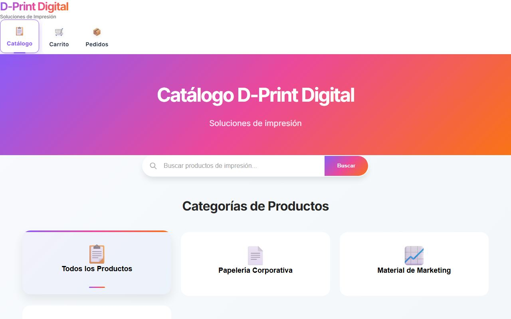

# 🎨 D-Print Digital

**Tienda online para gráficas e imprentas: el catálogo se carga desde un panel pensado para el celular y los pedidos llegan listos por WhatsApp.**

> Sitio de demostración del portfolio de [laruzo-dev](https://david-dev-ar.vercel.app/#demos). D-Print Digital es una imprenta ficticia: los productos y precios son de ejemplo.



🔗 [Ver en vivo](https://grafica-dani.vercel.app)

## ¿Qué problema resuelve?

Mandar listas de precios por chat o pedirle a un programador cada vez que cambia un precio es lento y lleno de errores. Con D-Print Digital la imprenta carga y edita sus productos desde el celular (con foto sacada en el momento) y la tienda se actualiza al instante. El cliente arma su pedido y lo envía listo por WhatsApp; los trabajos sin precio fijo se marcan "a cotizar".

## Funcionalidades

- Catálogo con categorías, buscador y productos destacados.
- Precio opcional: los productos sin precio muestran "Consultá precio" y en el pedido van "a cotizar".
- Carrito y formulario de pedido que arma el mensaje de WhatsApp (el servidor vuelve a leer nombres y precios de la base).
- Panel `/admin` con usuario y contraseña: alta, edición, borrado, ocultar/mostrar y fotos que se achican en el celular antes de subirse.
- Diseño adaptable a celular y escritorio, vista previa para compartir en WhatsApp y redes.

## Tecnologías

Next.js 15 (App Router), React, TypeScript, Prisma + Postgres (Prisma Postgres), Vercel Blob para las fotos y CSS propio. Desplegado en Vercel.

## Cómo correrlo localmente

```bash
npm install
cp .env.example .env         # completá las variables (ver abajo); Prisma y Next.js leen .env
npx prisma dev               # base Postgres local: copiá la URL TCP en DATABASE_URL y sumale &pgbouncer=true
npx prisma migrate deploy    # crea las tablas
npm run db:seed              # carga el catálogo de ejemplo (solo si la base está vacía)
npm run dev
```

Se abre en http://localhost:3000 y el panel en http://localhost:3000/admin.

## Variables de entorno

| Variable | Para qué sirve |
| --- | --- |
| `DATABASE_URL` | Conexión a Postgres. En Vercel la crea la integración de Prisma Postgres (Storage). |
| `BLOB_STORE_ID` | Subir fotos de productos. Vercel la crea al conectar un Blob Store al proyecto y se autentica sola con OIDC (sin token fijo). Sin ella, el panel funciona sin fotos. |
| `BLOB_READ_WRITE_TOKEN` | Alternativa a `BLOB_STORE_ID` para stores viejos (los que todavía crean el token). En local también podés usar `vercel env pull`, que trae `BLOB_STORE_ID` y `VERCEL_OIDC_TOKEN`. |
| `ADMIN_USERNAME` | Usuario del panel `/admin`. |
| `ADMIN_PASSWORD` | Contraseña del panel. |
| `AUTH_SECRET` | Clave para firmar la sesión (mínimo 32 caracteres, por ejemplo `openssl rand -base64 48`). |
| `WHATSAPP_NUMBER` | Opcional. WhatsApp que recibe los pedidos (solo números, con código de país). |

## Cómo se publica

En Vercel, `npm run build` aplica las migraciones (`prisma migrate deploy`), carga el catálogo de ejemplo si la tabla está vacía (`prisma db seed`) y después compila el sitio. `prisma generate` corre solo al instalar dependencias.

## ¿Querés una web así para tu negocio?

Desarrollo webs y sistemas a medida para comercios y emprendimientos. Mirá más demos en [david-dev-ar.vercel.app](https://david-dev-ar.vercel.app/#demos) o mis proyectos en [github.com/DavidSaboredo](https://github.com/DavidSaboredo).
