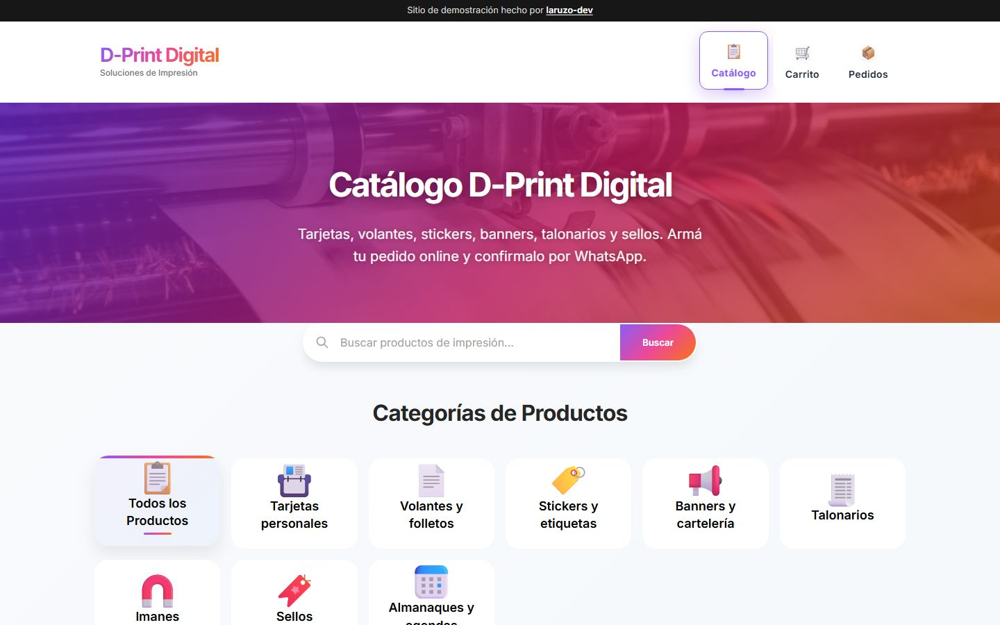
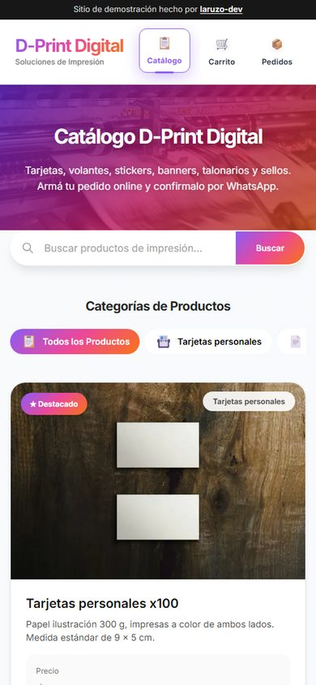

<div align="center">

# D-Print Digital

**Tienda online para gráficas e imprentas: el catálogo se edita desde el celular y los pedidos llegan listos por WhatsApp.**

[](https://grafica-dani.vercel.app)
<br>


<br>



</div>

> [!NOTE]
> Proyecto demo con datos de ejemplo de "D-Print Digital" (negocio ficticio).

## Qué resuelve

Mandar listas de precios por chat o pedirle a un programador cada vez que cambia un precio es lento y propenso a errores. Con D-Print Digital la imprenta carga y edita sus productos desde el celular, con la foto sacada en el momento, y la tienda se actualiza al instante. El cliente arma su pedido y lo envía listo por WhatsApp; los trabajos sin precio fijo quedan marcados como "a cotizar".

## Funcionalidades

- **Panel de administración**: alta, edición y borrado de productos, y botón para ocultarlos o mostrarlos, con usuario y contraseña.
- **Fotos desde el celular**: las imágenes se achican en el teléfono antes de subirse, para que la carga sea rápida.
- **Catálogo con categorías y buscador**, con productos destacados.
- **Precio opcional**: los productos sin precio muestran "Consultá precio" y en el pedido van como "a cotizar".
- **Carrito y formulario de pedido**: arma el mensaje de WhatsApp; el servidor vuelve a leer nombres y precios de la base de datos.
- **Adaptable a celular y computadora**, con vista previa para compartir en WhatsApp y redes.

## Capturas

<table>
  <tr>
    <td width="70%"></td>
    <td width="30%"></td>
  </tr>
  <tr>
    <td align="center"><sub>En la computadora</sub></td>
    <td align="center"><sub>En el celular</sub></td>
  </tr>
</table>

## Tecnologías

| Parte | Tecnología |
| --- | --- |
| Interfaz y servidor | Next.js 15 (App Router), React y TypeScript |
| Base de datos | PostgreSQL con Prisma (Prisma Postgres) |
| Fotos | Vercel Blob |
| Estilos | CSS propio |
| Publicación | Vercel |

## Para desarrolladores

<details>
<summary><b>Cómo correrlo en tu compu</b></summary>

```bash
npm install
cp .env.example .env         # completá las variables (ver abajo); Prisma y Next.js leen .env
npx prisma dev               # base Postgres local: copiá la URL TCP en DATABASE_URL y sumale &pgbouncer=true
npx prisma migrate deploy    # crea las tablas
npm run db:seed              # carga el catálogo de ejemplo (solo si la base está vacía)
npm run dev
```

Se abre en http://localhost:3000 y el panel en http://localhost:3000/admin.

</details>

<details>
<summary><b>Variables de entorno</b></summary>

| Variable | Para qué sirve |
| --- | --- |
| `DATABASE_URL` | Conexión a Postgres. En Vercel la crea la integración de Prisma Postgres (Storage). |
| `BLOB_STORE_ID` | Subir fotos de productos. Vercel la crea al conectar un Blob Store al proyecto y se autentica sola con OIDC (sin token fijo). Sin ella, el panel funciona sin fotos. |
| `BLOB_READ_WRITE_TOKEN` | Alternativa a `BLOB_STORE_ID` para stores viejos (los que todavía crean el token). En local también podés usar `vercel env pull`, que trae `BLOB_STORE_ID` y `VERCEL_OIDC_TOKEN`. |
| `ADMIN_USERNAME` | Usuario del panel `/admin`. |
| `ADMIN_PASSWORD` | Contraseña del panel. |
| `AUTH_SECRET` | Clave para firmar la sesión (mínimo 32 caracteres, por ejemplo `openssl rand -base64 48`). |
| `WHATSAPP_NUMBER` | Opcional. WhatsApp que recibe los pedidos (solo números, con código de país). |

</details>

<details>
<summary><b>Cómo se publica</b></summary>

En Vercel, `npm run build` aplica las migraciones (`prisma migrate deploy`), carga el catálogo de ejemplo si la tabla está vacía (`prisma db seed`) y después compila el sitio. `prisma generate` corre solo al instalar dependencias.

</details>

---

<div align="center">

Diseñado y desarrollado por **[laruzo-dev](https://laruzo-dev-ar.vercel.app)**
<br>
<sub>¿Querés un sistema así para tu negocio? <a href="https://laruzo-dev-ar.vercel.app/#contacto">Hablemos</a>.</sub>

</div>
